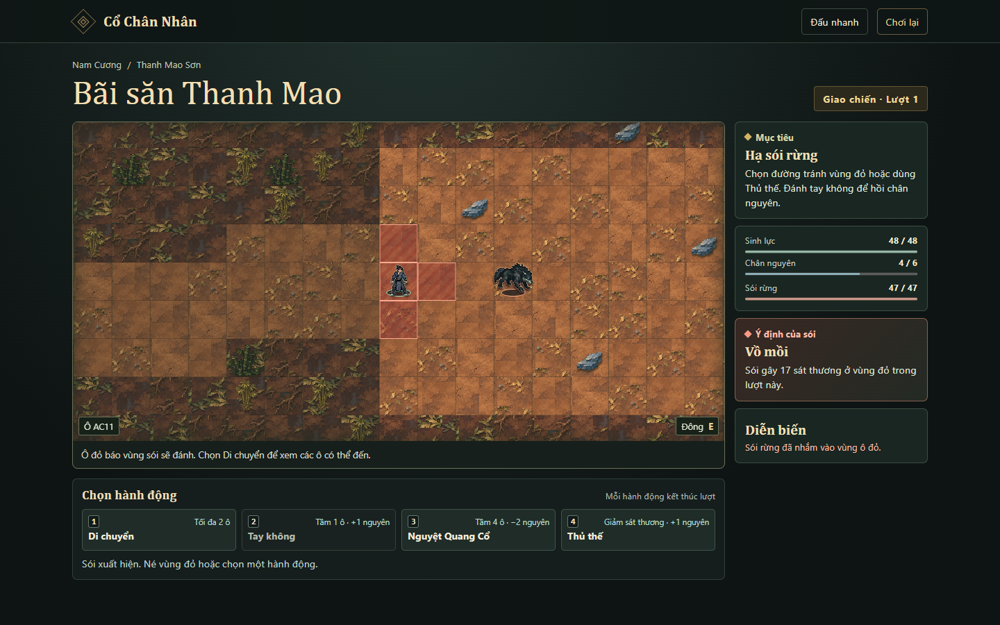

# Cổ Chân Nhân · Vượt Thanh Mao

Demo roguelike web theo lượt. Lượt chơi đầu bắt đầu ở Đại điển Khai Khiếu. Tư chất quyết định giới hạn chân nguyên khởi điểm, từ 4 ở Đinh đẳng đến 7 ở Giáp đẳng.

1. Chọn nhân vật, qua sông ngầm và hoàn thành Khai Khiếu.
2. Vượt ba màn theo lượt. Đọc ý định đối thủ và vùng nguy hiểm màu đỏ. Dùng các nút trên màn hình hoặc phím **1–4** để đi, đánh tay không, dùng Nguyệt Quang hoặc thủ thế.
3. Thắng một màn để chọn chiến lợi phẩm. Sinh lực, chân nguyên và sức mạnh tích lũy được mang qua màn sau. Vị trí đá thay đổi theo mã của lượt chơi.
4. Khi chết, chọn **Hồi sinh**. Bạn có thể làm lại Đại điển hoặc bỏ qua để dùng nhân vật và tư chất trước đó. Cả hai đều bắt đầu ở màn đầu với tài nguyên khởi điểm. Lượt đang chơi tiếp tục được sau khi tải lại.

Chạy `npm run preview` trong repo và mở [demo local](http://127.0.0.1:4173). Chạy `npm test` để kiểm thử.

`dist/roguelike.mjs` quản lý chu kỳ màn, chiến lợi phẩm và hồ sơ Khai Khiếu. Luật chiến đấu dùng chung từ `dist/combat.mjs`. Bản lưu lưu mã ngẫu nhiên và các hành động đã chốt để khôi phục bàn, đối thủ và tài nguyên.

## Bản Godot

Mở `godot-combat/project.godot` bằng Godot 4.7.2 Standard rồi bấm **F5**, hoặc chạy `godot --path godot-combat` từ thư mục repo. **F6** với cảnh `combat_preview.tscn` vẫn mở trận Điện Lang độc lập.

Chọn Huyền bào hoặc Áo rêu, qua sông ở Hang Nguyệt Lan và đi theo biển hoa để mở Không Khiếu. Dùng **WASD**, phím mũi tên hoặc bấm một ô để tới. Trong ba trận theo lượt, dùng **1–4**. Sau khi chọn Di chuyển, bấm ô hoặc dùng **phím mũi tên + Enter**. Ô xanh né được đòn đã báo. Ô hổ phách đi được và vẫn nằm trong vùng đánh. Rê chuột hoặc dùng Tab vào lệnh để xem sát thương và chân nguyên dự kiến. Qua mỗi màn đầu chọn một chiến lợi phẩm để mang sang màn sau.

Sau trận đầu, chọn **Khe đá Hoang Nha** hoặc **Lối săn tinh anh**. Vách đá ở Khe đá chặn Nguyệt Quang. Tinh anh luân phiên vồ và lao xuyên một hàng. Mũi tên đánh dấu hàng sắp bị quét. Thắng màn hai, chọn chiến lợi phẩm rồi dừng chân để hồi sinh lực, hồi chân nguyên hoặc đi thẳng vào hang. Cuồng Điện Lang luân phiên vồ và quét hành lang, nghỉ một lượt sau đòn nặng và đổi nhịp dưới nửa sinh lực.

**Ngọc Bì Cổ** là một lựa chọn thưởng sau màn đầu. Dùng phím **5** để tốn 1 chân nguyên và tạo lớp ngọc chặn tối đa 5 sát thương của đòn kế tiếp trong hai lượt. Có thể nhận **Sinh Cơ Diệp** sau trận Khe đá. Dùng phím **6** để tiêu một lá và hồi tối đa 12 sinh lực trước đòn đáp trả. Luyện Nguyệt Quang, hồi phục và Mở rộng Nguyên Hải vẫn có tác dụng như ghi trên thẻ thưởng.

Sau khi hạ Cuồng Điện Lang, chọn **Sang Nhị chuyển**. Ghép một Cổ Nhất chuyển với một Cổ Nhị chuyển rồi lần lượt đi qua **Sườn đá Mù Sương**, **Bãi Đá Suối Sấm** và **Hẻm Đá Phục Kích**. Có thể đổi bộ ở điểm nghỉ. Tại Suối Sấm, nước tím báo trước đòn dẫn lôi. Tại Hẻm Đá, ô nứt màu hổ phách báo trước đá rơi. Cả hai bên cần đường bắn thoáng để phóng đòn.

**7** dùng Cổ Nhị chuyển. Bộ Nguyệt dùng Nguyệt Quang để đặt ấn rồi kích phát bằng Nguyệt Mang. Bộ Hộ thể dùng Bạch Ngọc để tăng sức chặn và mở Phản đòn. Bộ Tửu hồi chân nguyên rồi cường hóa hai cú Tay không. Bộ Ẩn dùng Ẩn Thạch chuẩn bị bước đi xa và Ẩn Lân để làm địch mất dấu. Dùng hai Cổ hệ Ẩn nối tiếp giúp lần Di chuyển kế tiếp đi tối đa bốn ô. Có 16 cặp giữa bốn hệ. Sinh Cơ Diệp vẫn nằm ở ô vật phẩm.

Ở lượt mới, sau Sườn đá Mù Sương và Suối Sấm có thể chọn **Lều nghỉ**, **Quầy đổi đồ** hoặc **Biến cố**. Xem mức hồi, chi phí sinh lực hoặc chân nguyên trước khi chọn. Thắng hai trận này nhận nguyên thạch vào túi để mua Sinh Cơ Diệp hoặc một bảo vật. Hàng ở quầy theo mã lượt chơi. Bảo vật dùng chung với mọi bộ Cổ và đi theo bạn sang trận kế tiếp.

Sau Suối Sấm, **Săn tinh anh** dẫn vào **Ổ Điện Lang** thay cho một điểm dừng thường. Điện Lang đầu đàn luân phiên vồ vùng và lao xuyên hàng, với một lượt hồi thế sau đòn lớn. Thắng trận, chọn **Nanh Tinh Anh** để cộng 8 sát thương cho đòn đầu tiên gây sát thương mỗi trận, hoặc **Túi dược của thợ săn** để mang thêm một Sinh Cơ Diệp, hồi thêm sinh lực và giữ bảo vật đang mang. Cả hai lựa chọn dẫn về Hẻm Đá.

Sau Hẻm Đá, chọn **Tới Lôi Nha Đài** để chuẩn bị trận cuối Nhị chuyển. Cả hai lộ trình được hồi tối đa 32 sinh lực và 4 chân nguyên, giữ lá và bảo vật còn lại, rồi chọn bộ Cổ. Lôi Nha Trấn Ải quét điện theo hàng và chuyển sang đánh cả hàng lẫn cột khi còn nửa sinh lực. Rời các ô tím hoặc Thủ thế, rồi phản công trong lượt hở lôi giáp để cộng 5 sát thương. Thắng lần đầu nhận **Ấn Trấn Lôi**, mở khóa boss trong Luyện trận và giữ ấn khi bắt đầu lượt mới.

Sau Lôi Nha Đài, chọn **Sang Tam chuyển** để vào **Đầm Rễ Độc**. Hai cụm hồ vàng lục phun độc luân phiên. Nếu đòn phun làm mất sinh lực, bạn mất thêm 1 chân nguyên. Né cú Táp độc rồi phản công bằng Tay không lúc Điện Lang hở hàm để cộng 6 sát thương. Khi thắng, chọn **Tinh Lộ Tịnh Mạch** để tăng sức chứa chân nguyên thêm 1 và hồi đầy, hoặc **Cao giải độc** để hồi tối đa 18 sinh lực và nhận 2 Sinh Cơ Diệp.

Sau khi nhận thưởng Đầm Rễ Độc, chọn **Tới Hẻm Hàn Phong**. Đợt gió cắt đổi từ Tây sang Đông rồi ngược lại. Các ô có mũi tên báo vùng chịu đòn. Đứng sau tảng đá theo chiều gió để tránh sát thương. Thắng trận, chọn **Ấn Dẫn Phong** để hồi tối đa 2 chân nguyên ở lần Di chuyển đầu tiên thoát vùng báo đòn khi đang thiếu chân nguyên trong mỗi trận, hoặc **Túi Hàn Dược** để hồi tối đa 3 chân nguyên và nhận 2 Sinh Cơ Diệp.

Sau khi nhận thưởng Hẻm Hàn Phong, chọn **Tới Đài Trấn Ấn**. Thạch Giáp Lang giảm 8 sát thương mỗi đòn. Kết thúc Di chuyển trên ô ấn tím để khóa giáp 5 lượt. Tay không gây thêm 4 sát thương khi giáp đang vỡ. Thắng chọn **Thạch Tủy Luyện Thể** để tăng sát thương Tay không thêm 3 trong lượt chơi, hoặc **Hộp tiếp tế cổ trận** để nhận 6 nguyên thạch và 1 Sinh Cơ Diệp.

Sau khi nhận thưởng ở Đài Trấn Ấn, chọn **Tới Điện Trấn Mạch** để đánh Thạch Vương, boss cuối Tam chuyển. Boss luân phiên Nội Chấn và Ngoại Chấn. Di chuyển khỏi vùng báo đòn để mở **Hở mạch**, cộng 5 sát thương cho đòn trúng trong lượt hồi thế kế tiếp. Có thể dùng 8 nguyên thạch để **Dưỡng mạch** một lần, tăng sức chứa thêm 1, hồi đầy chân nguyên và hồi thêm tối đa 6 sinh lực. Thắng nhận **Ấn Trấn Mạch** để mở boss trong Luyện trận, rồi chọn Châu Hoàn Nguyên hoặc Rương Trấn Mạch.

Sau khi nhận thưởng Điện Trấn Mạch, chọn **Sang Tứ chuyển**. Người chơi theo đoàn buôn tới **bãi đá chân núi Tam Xoa**, bên ngoài phúc địa của truyền thừa Tam Vương. Dùng chân nguyên hoàng kim, né cú Húc giáp của chó Thiết Giáp, rồi đánh sườn để vượt lớp phòng ngự trước mặt. Thắng có thể giữ da làm giáp hoặc đổi lấy nguyên thạch.

Sau bãi đá, **trại tạm Tam Xoa** cho chọn nghỉ lấy sức hoặc đổi 6 nguyên thạch lấy 2 Sinh Cơ Diệp. Trên **Đường núi Tam Xoa**, chọn đánh cổ sư Nô đạo để ngắt lệnh, hoặc hạ khuyển thú trước. Cả hai chiếm ô riêng và có thể chắn đường phóng Cổ. Khi khuyển đã khóa ô, di chuyển để né hoặc thủ thế. Thắng mở đường đến cửa truyền thừa.

Sau khi thắng cổ sư Nô đạo, vào **cửa Tam Vương** để chọn truyền thừa. Cột lam **Tín Vương** dùng Hạc Giấy Cổ. Tại Đài luyện trong sương, điều lửa theo bí phương và hoàn thành ba công đoạn trước người Lông. Cột đỏ **Bạo Vương** dùng Bạo Trứng Cổ. Tại Bãi đá núi lửa, di chuyển dụ ba đối thủ vào cùng một vùng, ngắm để xem trước số trúng rồi thi triển. Cổ chỉ dùng được một lần.

Tại **cột sáng vàng của Khuyển Vương**, luyện hóa Ngự Khuyển Cổ nhất chuyển rồi bước vào vòng đầu. Phúc địa phong cấm bộ Cổ chiến đấu và bảo vật. Tiến vào tầm hai ô có đường thông, dùng phím `3` để thu phục chó hoang bằng 1 chân nguyên. Chó giữ nguyên sinh lực và cùng một Ngự Khuyển Cổ mới đi vào vòng hai.

Tại **Gò cỏ úa**, ba chó hoang áp sát từ ba phía. Ra lệnh cho chó vòng đầu bằng `2` để di chuyển hoặc `5` để táp. Dùng `3` chọn một chó hoang để thu phục. Sau khi thu phục, chọn chó A hoặc B trên sân, ở bảng bên phải hoặc đổi bằng `6`. Sân báo trước ô bị táp và giữ nguyên sinh lực còn lại của các chó sống khi qua vòng.

Ở **Hố đá dưới gò cỏ**, dùng vị trí hẻm giữa hai vách đá để chặn sáu chó hoang. Hai con khỏe tới trước, bốn con bị thương tới sau. Chó đồng minh mang nguyên thương thế từ vòng hai. Sau đó, ở **Khe đá hai lối**, chọn **Giữ cửa khe** hoặc **Vòng qua mỏm phải** để đặt đàn. Vòng bốn giữ đúng tài nguyên và thương thế ở kết quả hố đá. Sau khi thắng, vào **Hẻm Vọng Thanh** với nguyên thương thế của đàn. Ở vòng năm, táp trúng chó đầu đàn lúc sân báo **HÚ** để trì hoãn hai con tiếp viện. Ở vòng sáu tại **Bãi đá Chặn Đường**, nhấn `7` để chó đang chọn **Yểm hộ** bằng cách đổi chỗ với đồng minh đứng kề. Đòn đã báo vẫn đánh vào ô cũ. Ở vòng bảy tại **Khe đá Hàm Sói**, đường màu tím báo cú lao của chó đầu đàn. Rời các ô tím hoặc dùng Yểm hộ để đổi con chịu đòn đầu tiên.

Ngoài phúc địa, quầy vẫn bán lá và bảo vật, đồng thời có **Tiểu Quang Cổ** để hợp luyện. Một Nguyệt Quang và hai Tiểu Quang thành Nguyệt Mang. Dùng Nguyệt Mang cùng Tiểu Quang còn lại để phối **Liên Nguyệt**. Khi trang bị Nguyệt Mang đã sở hữu và còn Tiểu Quang trong Sổ Cổ, phím `8` dùng Liên Nguyệt một lần mỗi trận, tốn 4 chân nguyên để gây 42 sát thương cơ bản ở tầm 5 ô.

Mở **Sổ Cổ** để xem số còn lại và nguồn nhận của từng Cổ. Quầy bán thêm **Ngọc Bì Cổ** với 3 nguyên thạch. Nhận **2 Tiểu Quang Cổ** từ chiến lợi phẩm Sườn đá Mù Sương và **1 Bạch Thỉ Cổ** ở Bãi Đá Suối Sấm trước khi đi tiếp. Mỗi chiến lợi phẩm nhận một lần trong lượt chơi.

Ngoài trận, mở **Sổ Cổ** để hợp luyện **1 Ngọc Bì + 1 Bạch Thỉ → 1 Bạch Ngọc**. Có Bạch Ngọc và Tiểu Quang sở hữu thì có thể phối **Bạch Quang Hộ Thể**. Mang Bạch Ngọc trong bộ Cổ, nhấn `8` để dùng sát chiêu một lần mỗi trận, tốn 3 chân nguyên và chặn tối đa 9 sát thương mỗi đòn, trong hai đòn hoặc ba lượt. Hai sát chiêu dùng chung ô `8` theo Cổ Nhị chuyển đã chọn. Tiểu Quang là Cổ phụ trợ trong Sổ, vẫn giữ nguyên số lượng qua các trận.

Để sở hữu **Tứ Vị Tửu Trùng**, mua hai Tửu Trùng với 4 nguyên thạch và bộ Rượu Tứ Vị với 2 nguyên thạch. Mở Sổ Cổ ngoài trận để hợp luyện. Một mẻ dùng hết hai Tửu Trùng và cả bộ rượu. Có thể dùng 4 nguyên thạch từ Sườn đá Mù Sương và 2 nguyên thạch từ Bãi Đá Suối Sấm để gom đủ. [Bí phương trong chương 121](https://truyenhoan.com/co-chan-nhan/chuong-121.html)

Quầy bán **Ẩn Thạch** với 3 nguyên thạch và **Ngư Lân** với 2. Hợp luyện trong Sổ Cổ dùng một Cổ mỗi loại để sở hữu **Ẩn Lân**, có thể trang bị ở ô Nhị chuyển và dùng phím `7`. [Bí phương trong chương 123](https://tamhoan.com/co-chan-nhan/197826)

**Luyện trận** mở từ màn chọn nhân vật, trong trận và ở các điểm dừng giữa màn. Chọn đối thủ, nhân vật, tư chất, sinh lực, chân nguyên và bộ Cổ mang theo. **R** chơi lại với cùng thiết lập. Chọn **Đổi thiết lập → Quay lại** để tiếp tục lượt chính tại chỗ đã rời. Chế độ luyện có tiến độ riêng. [Kế hoạch các màn và Cổ](docs/ke-hoach-demo.md)

Bảy Cổ và Sinh Cơ Diệp có atlas và icon riêng trong Godot. Có thể vào Luyện trận để xem Nguyệt Mang thường hoặc kích phát Nguyệt Ấn, lớp Bạch Ngọc chịu đòn, Tứ Vị hai tầng và Điện Lang mất dấu khi gặp Ẩn Lân. Suối Sấm và Hẻm Đá có bộ ô riêng. [Chi tiết tích hợp đồ họa](docs/ke-hoach-demo.md#đồ-họa-trong-trận)

Sau khi gục, **Hồi sinh** mở lựa chọn Khai Khiếu lại hoặc dùng nhân vật và tư chất đã có để vào màn đầu. Chiến lợi phẩm, bộ Cổ, túi nguyên thạch và ô bảo vật được đặt lại. Bản Godot lưu tiến độ cục bộ ở `user://thanh-mao-run-v1.json` sau mỗi thao tác hợp lệ. Bản lưu v8 tại Hẻm Đá, v9 tại Lôi Nha Đài, v10 tại Đầm Rễ Độc, v11 tại Hẻm Hàn Phong, v12 tại Đài Trấn Ấn và v13 tại Điện Trấn Mạch có thể đi tiếp từ màn kết quả tương ứng. Phạm vi kiểm hiện tại là Windows.

```sh
godot --headless --path godot-combat --import
godot --headless --path godot-combat --fixed-fps 60 --script res://tests/preview_smoke.gd
godot --headless --path godot-combat --fixed-fps 60 --script res://tests/run_flow_smoke.gd
godot --headless --path godot-combat --fixed-fps 60 --script res://tests/art_smoke.gd
```

<details>
<summary>Tài liệu bản thử thú triều trước khi chuyển sang roguelike</summary>

Sau **Đại điển Khai Khiếu**, lên lũy tây **Cổ Nguyệt Sơn Trại** để tập dùng Nguyệt Quang. Khi bạn hồi đầy chân nguyên, **Cuồng Điện Lang** xuất hiện. Tĩnh Nghi ở lại phòng thủ và giao nhiệm vụ chạy về hậu trại gọi viện binh.

Sau khi xác nhận ở Đại điển, màn hình hiện **Vài năm sau đại điển** và **Thú triều tập kích sơn trại**. Chọn **Tiếp tục** để qua ngay. Giáo tập **Cổ Nguyệt Tĩnh Nghi**, Tam chuyển đỉnh phong, đón người chơi ở chân cầu thang. Chân dung và lời thoại hiện ở đáy màn hình. Chọn **Tới vị trí bắn** để đi theo lộ trình hướng dẫn, hoặc bấm **Esc** để tự đi.

Sơn Trại kéo dài theo trục bắc–nam. Khi mở bản đồ, bầy **Điện Lang** chạy từ rặng trúc bên trái qua khoảng đất trống tới chân lũy tây. Chúng thay nhau vồ vào cọc gỗ, làm bật dăm rồi lùi lấy đà. Con gặp ở bãi săn dùng cùng tạo hình và có động tác đứng, chạy áp sát, cắn, vồ và giật mình khi trúng đòn. Sprite Điện Lang hiển thị lớn hơn 35% ở cả hai cảnh. Thanh sinh lực bám theo tư thế khi sói chạy hoặc vồ.

Trên lũy có nữ cổ sư áo nâu dùng **Nguyệt Quang**, nam cổ sư áo xanh đá dùng **Nguyệt Toàn**, và nữ cổ sư áo chàm phóng **Tùng Châm**. Họ đánh hai mục tiêu bên sườn. Người chơi tập trên con Điện Lang ở giữa. Thanh sinh lực nằm trên đầu sói, còn máu bắn từ vị trí trúng đòn. Các atlas bay, va chạm và máu lấy từ bộ asset Antigravity. Trong truyện, Thanh Thư dùng nguyệt nhận xanh lục bay cong và phóng lá thông từ tóc. [Chương 22](https://truyenhoan.com/co-chan-nhan/chuong-22.html) · [Chương 104](https://tangthuvienhd.com/truyen/co-chan-nhan/chuong-104.html) · [Chương 141](https://vietnamthuquan.eu/TacPham/co-chan-nhan-25730/chuong-141)

Hai cổ sư tiếp viện đứng tại chốt. Người áo nâu đỏ ở đầu bắc phóng **Nguyệt Quang**. Người áo ngà thắt đai xanh ở phía nam phóng **Nguyệt Toàn**. Mỗi bộ sprite có bốn khung 128 × 128 cho đứng, thu tay lấy đà, phóng và thu thế. Hiệu ứng dùng lại các atlas của Antigravity.

Tường ngoài nhô thêm một ô ở góc đông bắc và bẻ vào trước cổng đông, nối lũy bắc với đoạn tường sát cổng.

[Kế hoạch hoàn thiện demo](docs/ke-hoach-demo.md)

Khi mở demo, chọn **Huyền bào** hoặc **Áo rêu** để vào Đại điển Khai Khiếu. Vượt sông ngầm, đọc chuyện Nhân Tổ và đi sâu vào vườn Nguyệt Lan tới khi Hy Vọng Cổ hội tụ. Sơn Trại tiếp nhận skin và độ sâu, rồi dùng cùng quy tắc với Đại điển để hiển thị tư chất và dung lượng Nguyên Hải trên HUD. Có thể mở trực tiếp `village.html` để thử lũy tây khi chưa chơi qua Đại điển. [Luật và nguồn truyện](docs/dai-dien-khai-khieu.md)



## Chơi thử

Cần Node.js 22 trở lên. Trong thư mục repo, chạy:

```sh
npm run preview
```

Mở [bản demo local](http://127.0.0.1:4173). Bản đồ có **42 × 26 ô**. Dùng WASD, phím mũi tên hoặc chạm một ô để đi tới đó. Các ô có vật cản chặn đường. Nếu đang đi theo một đường đã chọn, nhân vật dừng ở ô bắt đầu cuộc chạm trán.

Bấm **Shift** một lần để bật chạy khi khám phá, bấm lần nữa để về đi bộ. Nút **Chạy** dưới bản đồ cũng đổi chế độ và trình duyệt ghi nhớ lựa chọn. Huyền bào dùng dáng chạy riêng trên nền phẳng. Trên cầu thang, nhân vật đi từng bước ở lối giữa rộng một ô và trở lại nhịp đã chọn sau khi ra khỏi thang. Mỗi lượt **Chơi lại** chọn biến thể nền theo mã riêng và giữ vị trí các tuyến đường, cọc và bậc thang.

Bấm **F** hoặc chạm **Nguyệt Quang** để bắn. Mỗi phát tốn 2 chân nguyên. Khi cạn chân nguyên, nghe Tĩnh Nghi rồi xuống chỗ tiếp tế để một cổ sư khác lên thay. Bấm **E** hoặc chạm **Hấp thụ nguyên thạch** và đứng yên khoảng 1,5 giây. Rời ô trước khi xong sẽ giữ lại viên đá. Hoàn tất lưu điểm tiếp tế cho lần tải lại trong cùng phiên. Nút **Chơi lại** đặt lại cả tutorial.

Ngay khi dùng xong nguyên thạch, camera theo đợt sói mới và Cuồng Điện Lang tới lũy tây. Tĩnh Nghi chỉ đường về hậu trại rồi lên lũy dùng Huyết Nguyệt và Kim Chung Tráo. Có thể bấm **Esc** hoặc **Bỏ qua cảnh** để chuyển tới nhiệm vụ gọi viện binh. Tải lại trước khi xem xong sẽ phát lại từ đầu cảnh và giữ kết quả hấp thụ. Tải lại sau khi xem xong sẽ đưa bạn về mốc đang làm.

Ở hậu trại, bấm **E** hoặc chạm **Báo tin** để báo động cho đội trưởng. Hai cổ sư lên lũy tiếp viện. Theo đội trưởng qua cổng đông bên hông tới điểm tập kết và trao đổi trước khi vào bãi săn. Tải lại trong cùng phiên sẽ tiếp tục từ mốc báo tin, cổng đông hoặc điểm tập kết đã đạt.

Tới bìa bãi săn, bạn thấy đội tuần rừng phối hợp phá vây bằng Nguyệt Nghê Thường, Tùng Châm và Nguyệt Mang. Đi tiếp qua lối rừng để thấy một Điện Lang tách đàn. Sau tiếng hô **Cẩn thận!**, chọn **Vào trận** để bắt đầu hướng dẫn theo lượt. Dùng các nút trên màn hình hoặc phím **1–4** để chọn di chuyển, đánh tay không, phóng Nguyệt Quang hay thủ thế. Khi chọn di chuyển, chạm ô xanh hoặc dùng WASD/phím mũi tên cho bước kề bên. Mỗi hành động hợp lệ kết thúc một lượt. Né khỏi vùng đỏ trước khi kết thúc lượt.

Nếu gục, **Thử lại trận** đưa bạn về lượt một với chỉ số lúc chạm trán. Khi hạ Điện Lang, đội viện trợ cũng kết thúc trận. Một luồng khí tức ép xuống từ trên cao, Cổ Tiên xuất hiện, nói **“Tôm tép”** rồi vung tay chém xẻ bãi săn. Ánh sáng từ vết chém phủ trắng màn hình và hiện **Demo kết thúc**. Tải lại trước khi thắng đưa bạn về điểm tập kết, còn tải lại sau đòn kết liễu giữ màn kết. Nút **Chơi lại** đặt lại mốc.

Huyền bào và Áo rêu có atlas 128 × 128 riêng cho động tác lấy đà, phóng nguyệt nhận, thu tay và trúng đòn. Khung chuyển động lấy từ bộ đấm và phản ứng trúng đòn của chính hai skin. Điểm rời tay được đo riêng theo khung phát chiêu của mỗi skin.

### Đấu nhanh

Bản thử nghiệm theo lượt trước đây còn tại `/duel.html`, với bộ Cổ riêng có Bạch Ngọc Cổ và Sinh Cơ Diệp.


## Mã nguồn và kiểm thử

- `dist/combat.mjs` giữ quy tắc theo lượt dùng chung cho trận Điện Lang và Đấu nhanh.
- `dist/world.mjs` định nghĩa địa hình, tìm đường, nhịp tấn công theo thời gian thực và sát thương ở bãi săn. `dist/rampart-defense.mjs` điều khiển cảnh phòng thủ, đạn và hiệu ứng trúng đòn.
- `dist/expedition.mjs` nối bản đồ, camera và các cuộc chạm trán với bàn phím và cảm ứng. `dist/rampart-lesson.mjs` giữ các mốc bài tập và quy tắc hấp thụ. `dist/game.mjs` điều khiển trận Đấu nhanh.
- `dist/beast-king-raid.mjs` điều phối cảnh xuất hiện của Cuồng Điện Lang và các mốc nối lại. [Hồ sơ atlas và VFX](docs/thu-trieu-assets.md)
- `dist/reinforcement-post.mjs` điều quân tiếp viện và quản lý các điểm hẹn từ hậu trại tới bãi săn.
- `dist/forest-team.mjs` phát mô hình và VFX đội viện trợ trong cảnh rừng. `dist/forest-encounter.mjs` định nghĩa vị trí chạm trán, đấu trường và bộ hành động đầu game. [Hồ sơ tạo hình](docs/forest-support/README.md)
- `dist/forest-ending.mjs` và `dist/forest-ending.css` điều khiển đoạn kết tự chạy khoảng 4,7 giây. Mỗi nửa vết chém dùng địa hình từ bản đồ đang chơi. Sprite Cổ Tiên gồm bốn khung 192 × 192 px trong `dist/assets/forest-support/co-tien-ending.png`.
- `dist/assets/rampart/` chứa ba bộ hình 48 × 48 px cho nền, viền rừng và lũy gỗ. Xem cả [atlas nguồn và quy trình đóng gói](docs/tilesets/co-nguyet-rampart-v1).
- `dist/` là bản web tĩnh tự chứa. Demo chạy hoàn toàn trên trình duyệt, dùng dữ liệu trận riêng và chỉ giữ trạng thái trong phiên.

```sh
npm test
```

Đồ họa đường rừng và vật cản lấy từ dự án Discord Cổ Chân Nhân ở mốc `cb8b369f`. Lũy gỗ được ghép từ bộ ô làm theo ảnh Cổ Nguyệt Sơn Trại đã duyệt. Bộ **Huyền bào tay rộng** lấy từ bản Activity ở mốc `5738f80f`. Chỉ số và nhịp đánh được rút gọn cho demo.

Điện Lang phổ thông dùng atlas trong suốt 16 khung 128 × 128 ở `dist/assets/world/dien-lang.png`. Tốc độ, thị lực và cảnh công trại dựa trên truyện. Bờm xanh than và mắt bắt sáng nhẹ là lựa chọn tạo hình cho demo. [Chương 127](https://truyenhoan.com/co-chan-nhan/chuong-127.html) · [Chương 150](https://vietnamthuquan.eu/TacPham/co-chan-nhan-25730/chuong-150)

</details>
