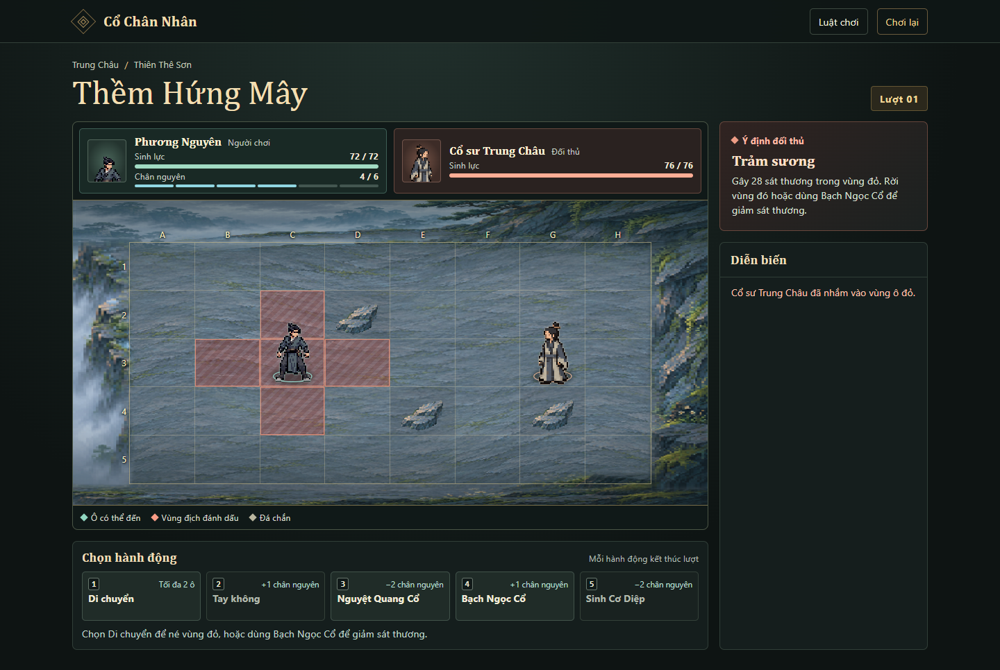

# Cổ Chân Nhân · Demo web

Sau **Đại điển Khai Khiếu**, lên lũy tây **Cổ Nguyệt Sơn Trại** để tập dùng Nguyệt Quang. Qua cổng đông để tới **bãi săn Thanh Mao**, nơi Điện Lang áp sát và vồ trong thời gian thực. Hạ sói để tiếp tục đi theo lối mòn phía đông.

Sơn Trại kéo dài theo trục bắc–nam. Khi mở bản đồ, bầy **Điện Lang** chạy từ rặng trúc bên trái qua khoảng đất trống tới chân lũy tây. Chúng thay nhau vồ vào cọc gỗ, làm bật dăm rồi lùi lấy đà. Con gặp ở bãi săn dùng cùng tạo hình và có động tác đứng, chạy áp sát, cắn, vồ và giật mình khi trúng đòn.

Trên lũy có nữ cổ sư áo nâu dùng **Nguyệt Quang**, nam cổ sư áo xanh đá dùng **Nguyệt Toàn**, và nữ cổ sư áo chàm phóng **Tùng Châm**. Họ đánh hai mục tiêu bên sườn. Người chơi tập trên con Điện Lang ở giữa. Thanh sinh lực nằm trên đầu sói, còn máu bắn từ vị trí trúng đòn. Các atlas bay, va chạm và máu lấy từ bộ asset Antigravity. Trong truyện, Thanh Thư dùng nguyệt nhận xanh lục bay cong và phóng lá thông từ tóc. [Chương 22](https://truyenhoan.com/co-chan-nhan/chuong-22.html) · [Chương 104](https://tangthuvienhd.com/truyen/co-chan-nhan/chuong-104.html) · [Chương 141](https://vietnamthuquan.eu/TacPham/co-chan-nhan-25730/chuong-141)

Tường ngoài nhô thêm một ô ở góc đông bắc và bẻ vào trước cổng đông, nối lũy bắc với đoạn tường sát cổng.

[Kế hoạch hoàn thiện demo](docs/ke-hoach-demo.md)

Khi mở demo, chọn **Huyền bào** hoặc **Áo rêu** để vào Đại điển Khai Khiếu. Vượt sông ngầm, đọc chuyện Nhân Tổ và đi sâu vào vườn Nguyệt Lan. Kết quả dựa vào độ sâu lớn nhất. Các cụm Hy Vọng Cổ màu vàng hồi sức đi tiếp. Nhân vật đã chọn theo bạn khi trở về Sơn Trại. [Luật và nguồn truyện](docs/dai-dien-khai-khieu.md)


## Chơi thử

Cần Node.js 22 trở lên. Trong thư mục repo, chạy:

```sh
npm run preview
```

Mở [bản demo local](http://127.0.0.1:4173). Bản đồ có **42 × 26 ô**. Dùng WASD, phím mũi tên hoặc chạm một ô để đi tới đó. Các ô có vật cản chặn đường. Nếu đang đi theo một đường đã chọn, nhân vật dừng ở ô bắt đầu cuộc chạm trán.

Bấm **Shift** một lần để bật chạy khi khám phá, bấm lần nữa để về đi bộ. Nút **Chạy** dưới bản đồ cũng đổi chế độ và trình duyệt ghi nhớ lựa chọn. Huyền bào dùng dáng chạy riêng trên nền phẳng. Trên cầu thang, nhân vật đi từng bước ở lối giữa rộng một ô và trở lại nhịp đã chọn sau khi ra khỏi thang. Mỗi lượt **Chơi lại** chọn biến thể nền theo mã riêng và giữ vị trí các tuyến đường, cọc và bậc thang.

Bấm **F** hoặc chạm **Nguyệt Quang** để bắn. Mỗi phát tốn 2 chân nguyên và có thời gian hồi. Chân nguyên phục hồi dần khi ngừng bắn. Ở bãi săn, dùng WASD, phím mũi tên hoặc chạm ô để thoát vùng màu đỏ trước lúc Điện Lang vồ. Nếu gục, chọn **Thử lại trận** để về lúc sói xuất hiện. Nút **Chơi lại** đặt lại cả tutorial.

### Đấu nhanh

Bản thử nghiệm theo lượt trước đây còn tại `/duel.html`, với bộ Cổ riêng có Bạch Ngọc Cổ và Sinh Cơ Diệp.



## Mã nguồn và kiểm thử

- `dist/combat.mjs` giữ quy tắc của bản Đấu nhanh theo lượt.
- `dist/world.mjs` định nghĩa địa hình, tìm đường, nhịp tấn công theo thời gian thực và sát thương ở bãi săn. `dist/rampart-defense.mjs` điều khiển cảnh phòng thủ, đạn và hiệu ứng trúng đòn.
- `dist/expedition.mjs` nối bản đồ, camera và chiến đấu thời gian thực với bàn phím và cảm ứng. `dist/game.mjs` điều khiển trận Đấu nhanh.
- `dist/assets/rampart/` chứa ba bộ hình 48 × 48 px cho nền, viền rừng và lũy gỗ. Xem cả [atlas nguồn và quy trình đóng gói](docs/tilesets/co-nguyet-rampart-v1).
- `dist/` là bản web tĩnh tự chứa. Demo chạy hoàn toàn trên trình duyệt, dùng dữ liệu trận riêng và chỉ giữ trạng thái trong phiên.

```sh
npm test
```

Đồ họa đường rừng và vật cản lấy từ dự án Discord Cổ Chân Nhân ở mốc `cb8b369f`. Lũy gỗ được ghép từ bộ ô làm theo ảnh Cổ Nguyệt Sơn Trại đã duyệt. Bộ **Huyền bào tay rộng** lấy từ bản Activity ở mốc `5738f80f`. Chỉ số và nhịp đánh được rút gọn cho demo.

Điện Lang phổ thông dùng atlas trong suốt 16 khung 128 × 128 ở `dist/assets/world/dien-lang.png`. Tốc độ, thị lực và cảnh công trại dựa trên truyện. Bờm xanh than và mắt bắt sáng nhẹ là lựa chọn tạo hình cho demo. [Chương 127](https://truyenhoan.com/co-chan-nhan/chuong-127.html) · [Chương 150](https://vietnamthuquan.eu/TacPham/co-chan-nhan-25730/chuong-150)
