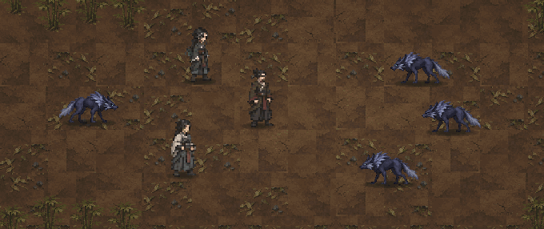

# Đội viện trợ trong rừng

[Xem khung thi triển ở kích thước đầy đủ](doi-vien-tro-pha-vay.png).

| Vai trong cảnh rừng | Tạo hình | Cổ sử dụng | Tệp chỉnh sửa |
| --- | --- | --- | --- |
| `opens-gap` · Đội trưởng | Nam, vai rộng, bào nâu đỏ, tóc búi | **Nguyệt Mang cổ** Nhị chuyển. Trăng lưỡi liềm mở lối qua đàn sói. | [Aseprite](moon-motion.aseprite) · [Atlas](../../dist/assets/forest-support/moon-motion.png) |
| `cover` · Cổ sư tuần rừng | Nữ, áo xanh rêu, tóc buông | **Tùng Châm cổ**. Tóc quét ra một loạt châm để ép sườn. | [Aseprite](pine-motion.aseprite) · [Atlas](../../dist/assets/forest-support/pine-motion.png) |
| `rear-guard` · Cổ sư hộ vệ | Nữ, tay áo ngà rộng, tóc tết | **Nguyệt Nghê Thường cổ** Nhị chuyển. Dải sáng quấn quanh thân rồi che cho người mở đường. | [Aseprite](raiment-motion.aseprite) · [Atlas](../../dist/assets/forest-support/raiment-motion.png) |

Trong truyện, Nguyệt Mang mạnh hơn Nguyệt Quang Nhất chuyển. Tùng Châm lấy ý từ cảnh Thanh Thư phóng châm bằng tóc, dùng bậc Nhị theo catalog của dự án. Nguyệt Nghê Thường có dạng dải sương và có thể chuyển sang bảo vệ người khác. [Chương 106](https://truyenmoiss.org/co-chan-nhan/chuong-106) · [Chương 104](https://truyenfull.today/co-chan-nhan/chuong-104/) · [Đoạn Nguyệt Nghê Thường ở Chương 104](https://kenhtruyenfull.com/doc-truyen/co-chan-nhan/quyen-1-chuong-104).

## Animation

- Mỗi người có 12 pose trong atlas 4 × 3, ô 128 × 128 px. Năm clip gồm đứng sẵn, đi, thi triển cổ, chao người rồi đứng vững, và ra hiệu bằng tay. Khung đứng là pose tĩnh.
- [Manifest](../../dist/assets/forest-support/team-motion.json) ghi thứ tự và thời lượng khung theo mili giây. Sprite quay phải. Điểm neo chân ở hàng 121. Mỗi cổ phát ở khung thứ ba của clip thi triển, tại mốc 305 ms. Tọa độ `releaseOrigin` tính từ góc trái trên của ô tương ứng.
- Bản dựng phá vây minh họa vị trí tương đối của đội và Điện Lang. Lưỡi trăng dùng hiệu ứng Nguyệt Quang có sẵn để thử độ lớn của Nguyệt Mang. Tùng Châm dùng atlas hiện có cùng vệt châm lấy hướng từ tóc. Dải Nguyệt Nghê Thường là hiệu ứng mẫu quanh hộ vệ và đội trưởng.
- Ba atlas đã nối vào cảnh rừng trên [bố cục bìa bãi săn](../forest-ambush/README.md). Đội viện trợ giữ chân bốn Điện Lang trong lúc người chơi đánh con tách đàn. Cả bốn gục khi người chơi ra đòn kết liễu, mở cảnh Cổ Tiên và màn kết demo.
